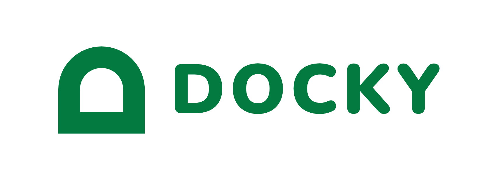
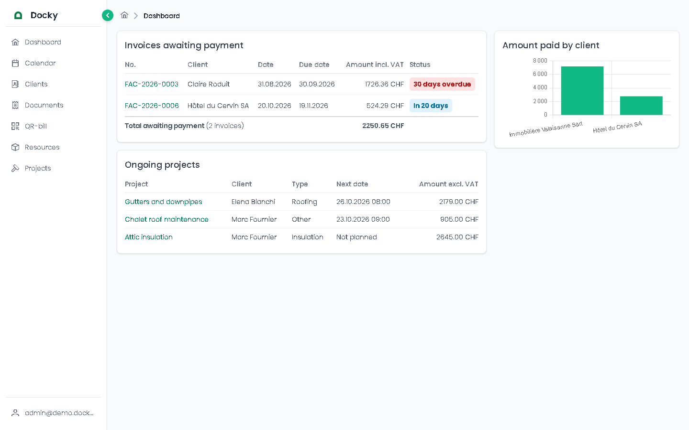
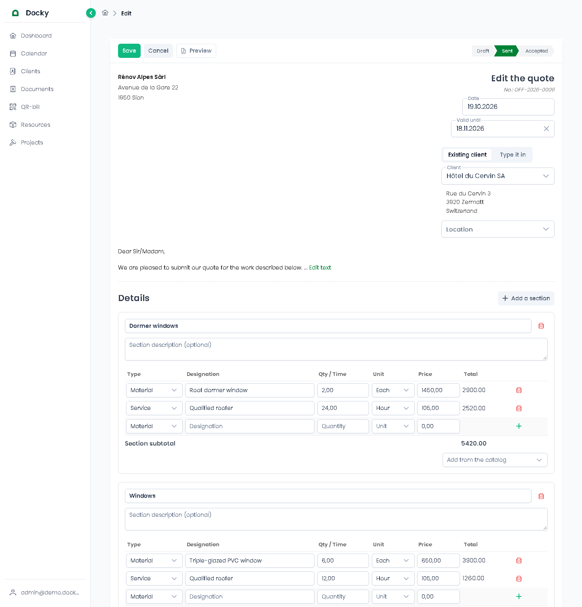
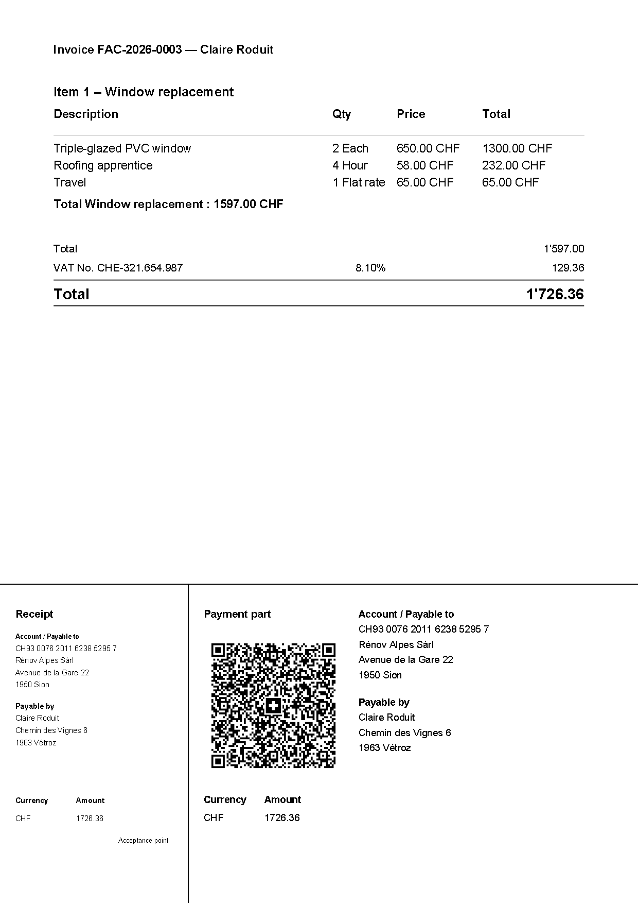
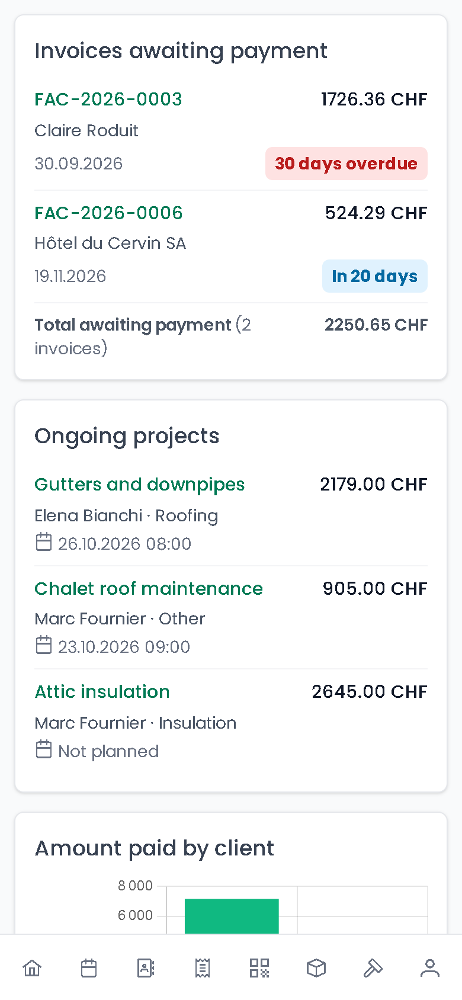
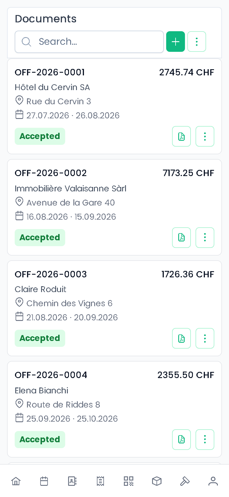

<p align="center">
  
</p>

<p align="center">
  Quotes, job sites and invoices for small construction companies.<br>
  A full-stack SaaS I'm building solo, from the database to the deployment.
</p>

<p align="center">
  <a href="https://github.com/OmarGriggio/Docky/actions/workflows/deploy.yml"></a>
  
  
  
  
  
</p>

*Last updated: 30.10.2026*

## Live demo

🔗 **[https://179-237-86-113.sslip.io](https://179-237-86-113.sslip.io)**

A demo company with realistic sample data (clients, quotes, job sites, invoices), in English - one click on **Try the demo** on the login page, or:

- **Email**: `admin@demo.docky.ch`
- **Password**: `Demo2026!`

Feel free to click around and change anything - the demo company is reset every Sunday.

## Screenshots

<table>
  <tr>
    <td width="50%"></td>
    <td width="50%"></td>
  </tr>
  <tr>
    <td align="center"><b>Dashboard</b> - invoices awaiting payment, ongoing job sites, amount paid per client</td>
    <td align="center"><b>Quote editor</b> - sections of priced lines, totals computed as you type</td>
  </tr>
</table>

<table>
  <tr>
    <td width="40%"></td>
    <td width="30%"></td>
    <td width="30%"></td>
  </tr>
  <tr>
    <td align="center"><b>Invoice PDF</b> with its Swiss QR-bill, generated by the backend</td>
    <td align="center" colspan="2"><b>On a phone</b> - lists turn into cards, navigation moves to a bottom bar</td>
  </tr>
</table>

## Table of contents

- [Live demo](#live-demo)
- [Screenshots](#screenshots)
- [About the project](#about-the-project)
- [Technical highlights](#technical-highlights)
- [Features](#features)
- [Roadmap](#roadmap)
- [Tech stack](#tech-stack)
- [Project structure](#project-structure)
- [Domain model](#domain-model)
- [API overview](#api-overview)
- [Getting started](#getting-started)
- [Documentation](#documentation)
- [Author](#author)

## About the project

Many small construction businesses still write their quotes and invoices in Excel, or pay for software that's expensive and hard to use. Docky is a focused alternative: build a quote from a catalog of materials and services, turn it into a job site ("chantier") once accepted, plan it on a calendar, then invoice it with a Swiss QR-bill - and see at a glance what's still unpaid.

It's a personal learning project, but built like a real product: it's shaped around a real construction company's way of working (its PDFs follow that company's own invoices), runs in production, and every change goes through review, tests and an automated deployment. Three kinds of users: **employees**, **company admins**, and a **platform admin** who runs the SaaS itself (details in [Project Definition.md](zz_docs/Project%20Definition.md)).

## Technical highlights

The parts I'd point a developer to - each one has its story in [Difficulties.md](zz_docs/Difficulties.md) (what broke and how it was found) or [Decisions.md](zz_docs/Decisions.md) (what was chosen over what, and why).

- **Multi-tenant isolation, audited.** Every query on a single record is scoped to the caller's company (taken from the token, never the request body), and so is every id a request body carries. An audit found cross-company leaks in nearly every module; they were fixed and the rule is now part of the conventions.
- **Transactions without threading a connection through every call.** `withTransaction()` keeps the transaction's connection in `AsyncLocalStorage`, and every repository queries through it. A review before merging caught one repository still going around it: ten concurrent saves were enough to deadlock the whole connection pool.
- **Business rules enforced on the server, race conditions included.** A sent invoice is never rewritten, only cancelled; a completed job site is invoiced once; accepting a quote is a conditional `UPDATE`, so two clicks at the same time never create two job sites.
- **Amounts that always add up.** Each line is rounded to the cent before summing, with the same tested function in the form, the API and the PDF - the printed total is the stored one, never recomputed in a template.
- **PDFs and Swiss QR-bills generated in-house**, laid out after a real company's own invoices and printed in the client's language. An incomplete IBAN or address comes back as a coded error the UI translates, not a 500.
- **Self-hosted error tracking instead of Sentry**, so no data leaves the server: errors grouped by fingerprint, a Discord alert for a new one that names its type and location, never its content.
- **Backups proven every night**: each dump is restored into a separate, network-less Postgres and checked before it replaces yesterday's copy - a broken backup never overwrites a good one.
- **Reviewed before shipping**: every merge to `main` goes through three review agents (business rules, security, code quality), then CI runs the tests and builds before deploying.

## Features

🚧 **Work in progress** - deployed and usable, still growing.

**For a company**
- Clients, a catalog of materials and services, quotes and invoices with sections, discounts and VAT
- Quote → job site → invoice, with the document lifecycle enforced (drafts editable, sent invoices locked)
- Job sites with their resources, file attachments and calendar planning, plus free calendar notes
- PDFs: quotes, invoices and payment reminders, invoices and reminders with a Swiss QR-bill, early payment discount; a standalone QR-bill slip to paste into Word
- Quotes and invoices for a one-off recipient, without creating a client first
- AI-assisted scanner: reads a scanned document (via Infomaniak's LLM) to prefill an invoice
- Dashboard: unpaid invoices (overdue first), ongoing job sites, amount paid per client
- French and English UI, per user; usable on a phone and installable on its home screen (PWA)

**Under the hood**
- Express + TypeScript API, `controller → service → repository`, raw SQL with no ORM ([why](zz_docs/Architecture.md))
- JWT access tokens + a revocable refresh token in an `httpOnly` cookie, roles, rate limiting, login history
- Platform admin can step into any company ("impersonation") to support it
- Archive instead of delete for business records; incremental SQL migrations applied on startup
- Vitest on the pure business logic (49 backend + 53 frontend tests) - no HTTP/database integration tests yet, they're next

**Operations**
- Docker Compose, multi-stage production images (compiled, non-root) behind Nginx, HTTPS with Let's Encrypt
- GitHub Actions: tests and builds on every push to `main`, then an automatic deploy over SSH
- Health check watched by an external uptime monitor, self-hosted error tracking with Discord alerts
- Nightly database backups, restored and checked automatically, 14 days kept

## Roadmap

What's planned next, roughly in that order:

- **Integration tests on the critical flows** - accepting a quote, saving a document, invoicing a job site - against a real database.
- **Sending documents by email, straight from the app** - invoices, quotes and payment reminders sent to the client with their PDF attached.
- **Stock module** - the materials a company holds, what goes in and out, and what each job site consumed.
- **Long-term purchase tracking** - what the company buys over time, to follow its spending and the prices it actually pays.

## Tech stack

| Layer            | Choice                       | Why                                                            |
| ---------------- | ---------------------------- | --------------------------------------------------------------- |
| Frontend         | Angular 21, PrimeNG, Tailwind CSS | Familiar framework with an architecture that fits business apps |
| Backend          | Node.js + Express + TypeScript | Lightweight, widely-used REST API stack                       |
| Database         | PostgreSQL                    | Robust, relational, fits business/invoicing data well            |
| Data access      | Raw SQL via a repository layer | Full control over queries, keeps the stack simple              |
| Authentication   | JWT + httpOnly refresh cookie  | Standard, stateless auth for a REST API, with revocable sessions |
| File storage     | MinIO (S3-compatible)          | Logos and job site attachments, same API as S3 if it ever moves  |
| PDFs             | pdf-lib + Swiss QR-bill        | Generated by the backend, no external service                    |
| Tests            | Vitest                         | Fast unit tests on the business logic, on both sides             |
| Deployment       | Docker Compose (dev + prod), Nginx gateway, GitHub Actions CI/CD | Reproducible environment; push to `main` tests, builds and deploys automatically |

## Project structure

```
Docky/
├── backend/                  # Express + TypeScript REST API
│   └── src/
│       ├── modules/          # One folder per domain (clients, catalog,
│       │                     #   projects, documents, calendar, dashboard,
│       │                     #   document-scanner, users, companies, auth),
│       │                     #   each with its own
│       │                     #   controller/service/repository/routes/types
│       ├── pdf/               # PDF & Swiss QR-bill generation
│       └── shared/
│           ├── middlewares/   # auth, roles, rate limiting
│           ├── types/         # typed HTTP errors
│           ├── config/        # DB connection (+ transactions), S3 client
│           ├── storage/       # file storage (MinIO/S3)
│           ├── migrations/    # applies new zz_migrations/ files on startup
│           ├── notifications/ # Discord alerts
│           └── ai/            # LLM client for the document scanner
├── frontend/                  # Angular application
│   └── src/app/
│       ├── shared/             # Shared models, components, services and global styles
│       └── features/           # Feature modules (clients, documents, projects...)
├── scripts/                    # Server cron jobs (demo reset, nightly backup)
├── zz_brand/                   # Logo files
├── zz_docs/                    # Project specs, architecture & decisions log
└── zz_migrations/              # Schema (000_base.sql) & seed data (001_data.sql),
                                 #   run on first boot by Postgres' own
                                 #   docker-entrypoint-initdb.d
```

## Domain model

The core entities and how they relate:

- **Company** — owns everything below; the tenant in this multi-company SaaS
- **User** — belongs to one company, has a role (employee/admin/platform_admin)
- **Client** — belongs to a company, has addresses, quotes, invoices and job sites
- **Resource** — a catalog item, either a material or a service (labor)
- **Document** — a quote, an invoice, or a job site's own resource ledger, made of sections of priced lines
- **Project** ("chantier") — a job site, born from an accepted quote (or created by hand), planned on the calendar and invoiced once completed

Full field-level definitions are in [zz_docs/Data Definition.md](zz_docs/Data%20Definition.md).

## API overview

All routes are prefixed by their resource name and return JSON. All are protected by the JWT `authenticate` middleware, except `/auth/login`/`/auth/refresh`/`/auth/logout`, the public registration (`POST /user`, which creates the company and its first admin together), the health check (`/health`, for an external uptime monitor) and the company logos (`/uploads/...`, read by plain `` tags).

| Resource                | Base path                  |
| ----------------------- | --------------------------- |
| Auth                    | `/auth` (login, refresh, logout, impersonate) |
| Login history           | `/login-history`             |
| Users                   | `/user`                      |
| Companies               | `/company`                   |
| Clients                 | `/client`                    |
| Addresses               | `/address`                   |
| Resources               | `/resource`                  |
| Resource units          | `/resource-unit`             |
| Documents               | `/document` (+ `/:id/content`, `/:id/accept`, `/:id/status`) |
| Document sections       | `/document-section`          |
| Document lines          | `/document-line`             |
| Documents (with lines)  | `/document-complete`         |
| Document templates      | `/document-template`         |
| Projects                | `/project`                   |
| Project types           | `/project-type`              |
| Project attachments     | `/project-attachment`        |
| Calendar notes          | `/calendar-note`             |
| Dashboard               | `/dashboard`                 |
| Document scanner        | `/document-scanner`          |
| Health check (public)   | `/health`                    |
| Error log               | `/error-log` (+ `/client` for browser reports) |
| PDFs                    | `/pdf/invoice/:id`, `/pdf/quote/:id`, `/pdf/reminder/:id`, `/pdf/qr-bill-slip` |

## Getting started

### Prerequisites

- Docker (runs PostgreSQL, MinIO and the API)
- Node.js (LTS) and the Angular CLI, for the frontend

### Backend

```bash
docker compose up --build
```

The API starts on `http://localhost:3000`, with a seeded database (logins in [CLAUDE.md](CLAUDE.md)'s "Seed data" bullet, all `password123`).

### Frontend

Runs outside Docker in development:

```bash
cd frontend
npm install
ng serve
```

The Angular app starts on `http://localhost:4200`.

### Environment variables

Two `.env` files are used, for two different consumers — copy both examples before running anything:

```bash
cp .env.example .env
cp backend/.env.example backend/.env
```

**Root `.env`** — read by `docker compose` itself, for variable substitution in [docker-compose.yml](docker-compose.yml):

| Variable                 | Description                          |
| ------------------------- | ------------------------------------ |
| `POSTGRES_VERSION`        | PostgreSQL Docker image tag          |
| `POSTGRES_CONTAINER_NAME` | Name of the Postgres container       |
| `POSTGRES_DB`             | Database created on first boot       |
| `POSTGRES_USER`           | Database user                        |
| `POSTGRES_PASSWORD`       | Database password                    |
| `POSTGRES_PORT`           | Host port mapped to Postgres' `5432` |
| `BACKEND_CONTAINER_NAME`  | Name of the backend container        |
| `BACKEND_PORT`            | Host port mapped to the API's `3000` |
| `MINIO_ROOT_USER`         | MinIO (file storage) admin user      |
| `MINIO_ROOT_PASSWORD`     | MinIO admin password                 |

**`backend/.env`** — loaded by the Express app itself at runtime:

| Variable      | Description                                                   |
| ------------- | --------------------------------------------------------------- |
| `DB_HOST`     | PostgreSQL host (`postgres`, the Compose service name)          |
| `DB_PORT`     | PostgreSQL port                                                  |
| `DB_USER`     | PostgreSQL user                                                  |
| `DB_PASSWORD` | PostgreSQL password                                              |
| `DB_NAME`     | PostgreSQL database name                                         |
| `JWT_SECRET`  | Secret used to sign/verify access tokens                        |
| `JWT_REFRESH_SECRET` | Secret used to sign/verify refresh tokens (separate from `JWT_SECRET`) |
| `COOKIE_SECURE` | `true` in production (HTTPS) to mark the refresh-token cookie `Secure`; leave unset locally |
| `S3_ENDPOINT` | File storage endpoint (`http://minio:9000`, the Compose service) |
| `S3_REGION` | File storage region |
| `S3_ACCESS_KEY` | File storage access key |
| `S3_SECRET_KEY` | File storage secret key |
| `S3_BUCKET` | Bucket for logos and project attachments (created on startup) |
| `INFOMANIAK_AI_PRODUCT_ID` | Product ID for Infomaniak's AI Tools, used by the document scanner |
| `INFOMANIAK_AI_API_TOKEN`  | API token for Infomaniak's AI Tools                             |
| `DISCORD_WEBHOOK_URL` | Discord channel webhook announcing a new (or returning) error - secret, leave empty locally |
| `APP_URL` | The app's public address, for the link in those announcements (optional) |

## Documentation

The `zz_docs/` folder contains the detailed specs this project is built from:

- [Project Definition.md](zz_docs/Project%20Definition.md) — problem statement, user types, user journeys
- [Data Definition.md](zz_docs/Data%20Definition.md) — entities, fields, relations
- [Architecture.md](zz_docs/Architecture.md) — architecture decisions and folder conventions
- [Deployment.md](zz_docs/Deployment.md) — VPS/SSH/HTTPS setup, CI/CD, the redeploy command, the weekly demo reset, backups and monitoring
- [Decisions.md](zz_docs/Decisions.md) — trade-off log for choices that had more than one reasonable option, with what was picked and what was turned down, and why
- [Difficulties.md](zz_docs/Difficulties.md) — problems actually hit while building this, and how they were diagnosed and fixed
- [zz_docs/note/](zz_docs/note/) — personal notes taken while learning Express, npm, and setting up the dev environment

## Author

**Omar Griggio**
📧 omar.griggio@gmail.com
🔗 [github.com/OmarGriggio](https://github.com/OmarGriggio)

This project is built for learning purposes and as part of my portfolio — feedback is welcome.